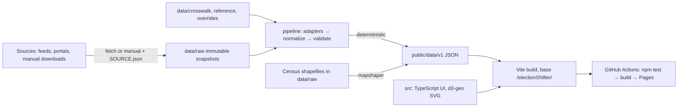

# electionShifter: Master Plan

Verified against live sources on 2026-11-09. Items marked UNVERIFIED were not confirmed.

## 1. Goal

A static web tool that compares any two races at county level and produces a map that can be read,
understood and shared at https://antimatterhut.github.io/electionShifter/.

v1 use cases:
1. Cross-year comparison: margin swing, raw margin shift, candidate vs candidate raw and % change.
2. Same-year, cross-race comparison (ticket splitting).
3. County groups: sum raw votes first, then compute margins. Never average percentages.
4. Sharing: a URL that restores the exact view, and a PNG with title, legend, races, source and status.

Coverage: every state plus a national view; 2026 and 2024 first; 2020, 2016, 2012 after v1.
Precinct and U.S. House are out of scope but must not be blocked.

### Assumptions
- A1. Today is 2026-11-09. 2026 data is unofficial until each state certifies.
- A2. "Baseline" is race A and "Comparison" is race B. Every change is B minus A.
- A3. Positive margin means Democratic lead. This is a sign convention, not a judgment.
- A4. Candidates are identified only from source data. App code contains no candidate names.
- A5. "Turnout" means total votes cast in the selected race. No voter-eligibility denominator in v1.
- A6. The repo is public, so unauthenticated GitHub API reads work for deploy checks.

### Repo state at planning time
- Local repo has no commits, is on branch `master`, and has no remote.
- `antimatterhut/electionShifter` exists on GitHub and is empty. Pages URL returns 404, as expected.
- `gh` is not installed on the owner's machine. Plans use `curl` against the public API instead.
- Whether the local git credentials can push as antimatterhut is UNVERIFIED.
- Local Node is 26.5 and Python 3.14. The project does not use Python.

## 2. Architecture



Everything is static. The pipeline runs locally. Raw and processed data are both committed, and CI
never touches the network for data. `npm test` rebuilds processed data from raw and fails on any
difference, which proves determinism.

Stack (reasons are in DECISIONS.md):

| Concern | Choice |
|---|---|
| Language | TypeScript everywhere; pipeline run directly by Node with type stripping |
| Build | Vite |
| UI | Vanilla TS modules and one small state store; no framework |
| Map | SVG with `d3-geo` and `topojson-client` (the only two runtime dependencies) |
| Geometry build | `mapshaper` (dev) |
| CSV | `csv-parse` (dev) |
| Tests | Vitest and Playwright (Chromium) |

Scripts must work on Windows and Linux: Node only, no bash in npm scripts, no `make`.

## 3. Data schema

### 3.1 Layout

```
data/
  raw/<source_id>/<snapshot YYYY-MM-DD>/<files, unmodified>
  raw/<source_id>/<snapshot>/SOURCE.json
  crosswalk/units.csv               canonical unit registry
  crosswalk/aliases.csv             source label → unit_id
  crosswalk/ct_town_to_region.csv
  reference/statewide_totals.csv    independent totals for Tier 2 validation
  overrides/race_map.csv            source contest → race_id
  overrides/alignment.csv           owner-approved party alignment
  overrides/excluded_rows.csv       documented row exclusions
pipeline/
  cli.ts  fetch/  sources/<adapter>.ts  normalize.ts  validate.ts  emit.ts  geo.ts
public/data/v1/
  manifest.json
  units.json
  geo/states/<ST>.topo.json  geo/national.topo.json
  races/<year>/<ST>/<race_id>.json
src/
  domain/  (pure: metrics, aggregation, scales, url state)
  ui/  main.ts  index.html
tests/
  unit/  data/  e2e/  fixtures/
```

`data/raw/**` is byte-exact. `.gitattributes` sets `data/raw/** -text` to stop line-ending changes.
Snapshots are never edited; a refresh adds a new snapshot directory.

### 3.2 `SOURCE.json`

| Field | Type | Notes |
|---|---|---|
| source_id | string | e.g. `pushbuild-2026` |
| snapshot | string | `YYYY-MM-DD` |
| retrieved_at | ISO string | |
| method | `scripted` or `manual` | |
| urls | string[] | |
| upstream_commit | string or null | Git sources only |
| license | string | |
| files | `{path, sha256, bytes}[]` | `npm test` re-verifies every hash |
| notes | string | |

### 3.3 Canonical key: `unit_id`

| Unit | Format | Example |
|---|---|---|
| County or equivalent | 5-digit FIPS | `48085` |
| Virginia independent city | 5-digit FIPS | `51510` |
| Connecticut planning region | 5-digit FIPS (2022+) | `09110` |
| Alaska House district | `02H` + 2 digits | `02H07` |
| Votes not assignable to a unit | state FIPS + `999` | `25999` |

`units.csv` columns: `unit_id, state_po, name, kind, geo_key, valid_from, valid_to`.
- `kind`: `county`, `independent_city`, `planning_region`, `ak_house_district`, `unallocated`.
- `geo_key` joins to geometry; empty for `unallocated`.

`aliases.csv` columns: `source_id, state_po, source_label, unit_id`.

Crosswalk process:
1. Normalize a label for lookup only: uppercase, trim, collapse spaces, strip punctuation and accents.
2. Look up source-specific alias, then generic alias (`source_id` = `*`), then exact unit name in state.
3. An unmatched label is a pipeline error. Never guess or fuzzy match. Add an alias row.

Known issues to seed: Saint/St., Ste. Genevieve, DeWitt, LaSalle, Doña Ana, Baltimore city vs county,
St. Louis city vs county, Bedford city (51515, merged into 51019 in 2013), Shannon → Oglala Lakota
(46113 → 46102), Kalawao HI (15005), VA uppercase `ALEXANDRIA CITY`, AK labels such as
`District District 1 ` and blank labels at `level=county`.

### 3.4 Geography versioning

There is **one current comparison geography**, `geo_version = "2025c"`, built from
`cb_2025_us_county_5m.zip`. Every race from every year is rolled onto it. This guarantees two races
always share units.

- Older years use crosswalks onto current units, including Bedford and Oglala Lakota.
- Connecticut uses 9 planning regions for all years. Town-level results roll up via
  `ct_town_to_region.csv`. Eight-county historical data cannot be used unless town data exists.
- ME, MA, NH, RI, VT: town results roll up to county.
- Alaska: 40 House districts from `cb_2024_02_sldl_500k.zip`. Before accepting Alaska, confirm both
  2024 and 2026 use the same plan. For pre-2022 years, Alaska shows statewide only unless a plan
  crosswalk is built.
- Future precinct work adds a `geo_version` and unit kind; House adds office and seat values. Neither
  changes the race file shape.

### 3.5 `race_id`

`{year}-{ST}-{office}[-{seat}]-{stage}`, lowercase except state, e.g. `2026-TX-us-senate-gen`,
`2024-TX-president-gen`, `2026-TX-railroad-commissioner-gen`.
- `office`: `president`, `us-senate`, `governor`, or a slug from `race_map.csv`.
- `seat`: optional, e.g. `special`, `place-2`, `pos-1`, `d07`.
- `stage`: `gen`, `runoff`. Default views use `gen`.

### 3.6 `manifest.json`

```ts
{ schema_version: 1, geo_version: "2025c",
  build_hash: string,                 // sha256 of inputs; never a timestamp
  races: RaceMeta[],
  coverage: { year:number, state_po:string, office:string, state:"ok"|"statewide_only"|"partial"|"pending", note:string }[] }
RaceMeta = {
  race_id:string, year:number, election_date:string, state_po:string, office:string, office_label:string,
  seat:string|null, stage:"gen"|"runoff", status:"unofficial"|"certified", as_of:string,
  source_ids:string[], source_label:string, file:string, unit_count:number,
  has_dem:boolean, has_rep:boolean, method_note:string|null,
  validation:{ tier1:"pass"|"na", tier2:"pass"|"pending", max_diff_pct:number }
}
```

### 3.7 Race file

```ts
{ schema_version:1, race_id:string,
  units:string[],                 // unit_ids, sorted ascending
  candidates:{ candidate_id:string, name:string, party:string, group:"D"|"R"|"L"|"G"|"I"|"O", aligned:"D"|"R"|null }[],
  votes:(number|null)[][],        // votes[candidate][unit]; null = not reported
  other_votes:(number|null)[],    // write-ins and scatter, per unit
  total_votes:(number|null)[]     // sum of candidates + other_votes
}
```
All vote fields are integers. Percentages are never stored; they are computed in `src/domain`.

Normalization rules:
- `candidate_id` is a slug of the source name. Identity comes only from source data.
- **Fusion:** rows for one candidate on several lines (e.g. D and WF) are summed to one candidate.
  `group` is the major-party line if any; otherwise the first line by votes.
- Combined party codes such as `DEM/NON` use the first recognized party. Record in `method_note`.
- Write-ins go to `other_votes`. Named ballot candidates are always kept.
- Totals exclude blanks, undervotes and overvotes.
- Ranked choice: use first-round votes and set `method_note`.
- A `*` or suppressed value is `null`, never 0.
- MEDSL `mode` rows: use `TOTAL` if present for that county and candidate, otherwise sum all modes.
  Never filter on `TOTAL` alone; it silently drops counties.

## 4. Metrics

Let D and R be group vote sums (`group`, or `aligned` when set), and T the total votes.
Worked example: Collin County, TX. A = 2024 President, B = 2026 Senate (snapshot of 2026-11-09).

| | D | R | T |
|---|---|---|---|
| Collin A | 222,115 | 279,534 | 517,690 |
| Collin B | 252,403 | 197,096 | 457,641 |
| Denton A | 191,503 | 250,521 | 449,188 |
| Denton B | 211,266 | 177,859 | 396,235 |

| Metric | Formula | Result (Collin) |
|---|---|---|
| Raw margin | `D − R` | A: −57,419; B: +55,307 |
| Margin (default) | `(D − R) / T` | A: −11.09; B: +12.09 pts |
| Margin (two-party) | `(D − R) / (D + R)` | A: −11.45; B: +12.30 pts |
| Margin swing | `margin_B − margin_A` | +23.18 pts |
| Raw margin shift | `rawmargin_B − rawmargin_A` | +112,726 |
| Candidate change, raw | `V_B − V_A` | Harris → Talarico: +30,288 |
| Candidate change, % | `(V_B − V_A) / V_A` | +13.64% |
| Turnout change, raw | `T_B − T_A` | −60,049 |
| Turnout change, % | `(T_B − T_A) / T_A` | −11.60% |
| Shift from margin change | `(m_B − m_A) × T_A` | +119,983 |
| Shift from turnout change | `m_B × (T_B − T_A)` | −7,257 |

The last two sum exactly to raw margin shift (119,983 − 7,257 = 112,726). They appear in tooltips so
a reader can see how much of a shift is turnout. For two-party basis, use `T = D + R` in these two.

**Group aggregation** sums each input over available units, then applies the same formulas.
Collin + Denton: A = 413,618 / 530,055 / 966,878; B = 463,669 / 374,955 / 853,876.
- Margin A = −116,437 / 966,878 = −12.04. Margin B = +88,714 / 853,876 = +10.39.
- Swing = **+22.43**. Raw margin shift = +205,151. Turnout = −11.69%.
- Averaging the two county swings gives 22.37. That is wrong, and a test must prove the code gives 22.43.

Edge cases:

| Case | Behavior |
|---|---|
| No D or no R, and no alignment override | Margin metrics unavailable; show "Not comparable: no D–R contest" |
| Multiple candidates in a party (e.g. AK) | Sum the group |
| `V_A = 0` for % change | Show "n/a"; raw change still shown |
| `T = 0` or null | Missing |
| Unit missing in either race | Hatched; excluded from a group, with count shown ("2 of 5 counties have data") |
| Candidate not on ballot in the race | Candidate mode offers only candidates in that race |

Mixed status: if either race is unofficial, the view is labeled unofficial.

## 5. Map design

### Scales
All scales are diverging, symmetric and centered on zero, with a neutral center bin.
Bins are fixed so that two maps of the same metric can be compared.

| Metric | Colors | Bin edges (±) |
|---|---|---|
| Margin, margin swing | Red–blue (R negative, D positive) | 1, 3, 6, 10, 15, 25 pts |
| Raw margin, raw shift | Red–blue | Edges from 1-2-5 values chosen by the largest absolute value in view |
| Candidate change raw and % | Purple–green (not partisan) | % : 2, 5, 10, 20, 35, 50; raw as above |
| Turnout change % | Purple–green | 2, 5, 10, 20, 30, 40 |

Raw scales are per view; the legend states this. Use a ColorBrewer-derived 7-step ramp per side and
a neutral light gray center. Missing is a diagonal hatch, distinct from every data color.

### Reading aids
- Title in plain English: "How Texas shifted: 2026 Senate vs. 2024 President".
- Subtitle says what color means: "Blue = shifted toward Democrats".
- Legend always shows units, Missing, and which direction is which.
- Status badge: amber "UNOFFICIAL as of <date>" or green "CERTIFIED".
- **Turnout notice** when a midterm is compared with a presidential race, or total votes changed
  more than 10%: "Fewer people voted in 2026, which shrinks raw vote numbers everywhere. Margin swing
  isn't affected by total turnout the same way. See the Turnout view."
- Each metric has a one-sentence definition next to the selector.

Labels: state view labels the 10 units with the largest absolute metric value, with collision
avoidance. National view labels states only.

Tooltip fields: unit name; A and B D/R votes and margin; metric value with sign; total votes in both;
the turnout/margin decomposition; "Missing in <race>" where applicable. It must work by keyboard focus
and tap, not only hover.

Accessibility: visible focus, `aria-label` per unit, and a sortable data table of what the map shows.

## 6. Data sources

Status: V = verified 2026-11-09; U = unverified.

| Source | Coverage | Format / access | License | Issues |
|---|---|---|---|---|
| pushbuild/us-2026-election-results | 2026 general, statewide and county. V | CSV `data/<st>.csv`; scripted raw fetch. Columns: state, level, county, contest, candidate, party, votes, pct, contestTotalVotes, precinctsReporting, precinctsTotal, source, sourceUrl, sourceUpdatedAt, fetchedAt | CC0 (V) | Unofficial; snapshot Nov 6; no FIPS; small project with unknown maintainer; contest names vary by state; says it will refresh after certification |
| MEDSL countypres 2000–2024 (doi:10.7910/DVN/VOQCHQ, v20, 2026-02-25) | President by county. V | Tab file about 9.8 MB. **Manual**: API returns "required Guestbook response" | CC0 (V) | Contents not inspected because download was blocked; `mode` trap |
| MEDSL/2024-elections-official | `2024-president-state.csv`, `2024-senate-county.csv`, `2024-senate-state.csv`, `individual_states/` precinct. V | CSV; scripted | Repo has no license file (V). U for reuse; owner decision in §9 | `votes="*"` suppression; Maine first-round |
| Texas Capitol Data Portal 2024 | TX VTD results for all offices. V | CSV API `https://ted.capitol.texas.gov/api/Offices/510/<id>/vtd`; President=1, Senate=2; ids 3–4 returned HTTP 500. First 3 digits of `CNTYVTD` = county FIPS | CC BY (V) | Harris 4,835,134 vs 4,835,250 elsewhere; TX total 11,404,528 vs 11,380,105 in tonmcg |
| tonmcg county results | President 2008–2024. V | CSV; scripted | MIT (V) | README says not authoritative; 2024 scraped from Fox. **Cross-check only** |
| OpenElections | State repos; TX 2024 precinct in progress; no 2026 general seen. V | CSV; scripted | No license file seen in TX repo. U | Uneven coverage. Later precinct work |
| Census cartographic boundaries | County 2025 and 2024; AK SLDL 2024 (HTTP 200). V | Shapefile zip; scripted | Public domain (U in writing) | Planning regions in 2025 file must be asserted by a test |
| State SoS sites | Official results | Varies. TX archive portal blocked automated fetch (403). **Assume manual** | Generally public record (U) | Formats differ |
| CT electionhistory.ct.gov | Town-level CT results. V exists | Web; export format U | U | Needed for CT |
| us-atlas | Counties, 2017 edition | TopoJSON | ISC | **Not used**: stale |

2026 feed coverage (README table, V). Row counts not repeated.
- County rows: AK, AR, AZ, CO, CT, FL, GA, IA, ID, IN, LA, MD, MN, MO, NC, OH, PA, RI, SC, TX, UT, VA, WA.
- Statewide only: AL, CA, DE, NE, NM, SD, VT.
- Partial: KS, MI, NJ, WI.
- Candidate list only: IL, MA, NV, NY, WY.
- Not listed: HI, KY, ME, MS, MT, ND, NH, OR, TN, WV, and DC (derived from the table).

Coverage of specific offices within each state is U until Phase 11 inventories it.

Validation:
- **Tier 1 (internal):** county rows sum to the same source's statewide row.
- **Tier 2 (independent):** county sums match `reference/statewide_totals.csv`, from a different and
  preferably official publication.

| Data | Tolerance per D/R/top-3 candidate |
|---|---|
| Certified, Tier 2 | `max(50 votes, 0.05%)` |
| Unofficial, Tier 1 | `max(50 votes, 0.10%)` |
| Unofficial, Tier 2 | Reported only; `pending` until certification |

A violation fails `npm test`. Exceptions go in `excluded_rows.csv` or the reference file with a written
reason. A candidate's tolerance may not be raised to make a test pass.

`statewide_totals.csv` columns:
`race_id, candidate_match, votes, total_votes, status, source_url, retrieved, note`.

## 7. National view

- **President mode:** all counties, one race, 2024.
- **Mosaic mode (midterm):** each state uses one selected race. Default rule: U.S. Senate, else
  Governor, else no data. A toggle prefers Governor first. A state's race is shown in the tooltip.
- A persistent label reads "Mosaic: different races in different states. Not one national contest."
- National totals are computed only in President mode. Mosaic shows no national aggregate.
- Group selection is limited to state views in v1.
- Alaska and Hawaii appear as insets.

## 8. Roadmap

Every phase ends committed, pushed, with `npm test` green and the deploy successful.
"CP" is a commit-and-push checkpoint. "Golden" values use the snapshot pinned in Phase 4.
Windows note: use Node for scripts.

---

### Phase 1: Repository and deploy
**Goal:** placeholder page live. No data work.
**Prerequisites:** owner has saved `plan.md` to the repo root; owner can push to the repo.
**Files:** README.md, .gitignore, .gitattributes, .env.example, .nvmrc, CLAUDE.md, PROGRESS.md, DECISIONS.md,
MASTER_PLAN.md, KICKOFF_PROMPTS.md, DEFINITION_OF_DONE.md, package.json, tsconfig.json, vite.config.ts,
index.html, src/main.ts, src/domain/version.ts, tests/unit/version.test.ts, .github/workflows/deploy.yml.

**Tasks:**
1. Run `git branch -M main`, then `git remote add origin https://github.com/antimatterhut/electionShifter.git`.
2. Split `plan.md` at its `<!-- FILE: name -->` markers into MASTER_PLAN.md, CLAUDE.md, PROGRESS.md, DECISIONS.md, KICKOFF_PROMPTS.md and DEFINITION_OF_DONE.md, copying each part's text unchanged. Keep `plan.md`.
3. Run `npm init`-equivalent; `"type":"module"`, private true. Add dev deps: typescript, vite, vitest.
4. tsconfig: strict, `noEmit`, `allowImportingTsExtensions`, `erasableSyntaxOnly`.
5. `vite.config.ts`: `base: '/electionShifter/'`.
6. `npm test` = `tsc --noEmit && vitest run && vite build`.
7. `.nvmrc`: `26`. If setup-node cannot resolve it, record this under Known Issues and pin the nearest available LTS in both places.
8. `.gitattributes`: `* text=auto` and `data/raw/** -text`.
9. `.gitignore`: node_modules, dist, .env, test-results, playwright-report.
10. Placeholder page: title "electionShifter", and "Coming soon".
11. `.github/workflows/deploy.yml` as below.
12. Commit and push (CP1).
13. Ask the owner to set Settings → Pages → Source to **GitHub Actions**. Wait for confirmation, then re-run by pushing a small README update (CP2).
14. Check `https://api.github.com/repos/antimatterhut/electionShifter/actions/runs?branch=main&per_page=1` and the live URL with curl.

```yaml
name: Test and deploy
on:
  push: { branches: [main] }
permissions: { contents: read, pages: write, id-token: write }
concurrency: { group: pages, cancel-in-progress: true }
jobs:
  build:
    runs-on: ubuntu-latest
    steps:
      - uses: actions/checkout@v4
      - uses: actions/setup-node@v4
        with: { node-version-file: .nvmrc, cache: npm }
      - run: npm ci
      - run: npm test
      - run: npm run build
      - uses: actions/upload-pages-artifact@v3
        with: { path: dist }
  deploy:
    needs: build
    runs-on: ubuntu-latest
    environment: { name: github-pages, url: "${{ steps.d.outputs.page_url }}" }
    steps:
      - id: d
        uses: actions/deploy-pages@v4
```
Also add `"build": "vite build"`.

**Tests:** `version.test.ts` asserts the exported schema version is 1.
**Acceptance:**
- `npm test` exits 0 locally.
- Latest Actions run on `main` has conclusion `success`.
- Live URL returns 200 and contains "electionShifter"; its JS asset URL includes `/electionShifter/`.
- A failing test blocks deploy, shown by the `needs: build` dependency. Do not push a failing test to prove it.

**Out of scope:** data, maps, UI.

### Phase 2: Metrics library
**Goal:** every metric and aggregation as tested pure functions.
**Prerequisites:** Phase 1.
**Files:** `src/domain/types.ts`, `metrics.ts`, `aggregate.ts`, `tests/unit/metrics.test.ts`, `tests/unit/aggregate.test.ts`.
**Tasks:**
1. Define `RaceFile`, `RaceMeta`, `Basis` (`total`|`two_party`), `MetricId` from §3 and §4.
2. Implement `unitTotals`, `margin`, `rawMargin`, `marginSwing`, `rawShift`, `candidateChange`, `turnoutChange`, `decomposeShift`.
3. Implement `aggregateUnits(race, unitIds)`, summing before any metric, using `aligned ?? group`.
4. Implement all §4 edge cases by returning `null` plus a reason code. CP.

**Tests:** every row in §4; Collin + Denton = +22.43 and not 22.37; decomposition sums exactly; multiple same-party candidates; missing unit; zero baseline; no-R race.
**Acceptance:** tests above pass with printed output; `src/domain` imports nothing from the DOM.
**Out of scope:** UI, data files.

### Phase 3: Texas geometry and unit registry
**Goal:** Texas county geometry and canonical units.
**Prerequisites:** Phase 2.
**Files:** `pipeline/cli.ts`, `pipeline/fetch/census.ts`, `pipeline/geo.ts`, `pipeline/lib/hash.ts`, `data/crosswalk/units.csv`, `aliases.csv`, `data/raw/census-cb/<date>/...`, `public/data/v1/units.json`, `public/data/v1/geo/states/TX.topo.json`, `tests/data/geo.test.ts`, `tests/data/raw-integrity.test.ts`.
**Tasks:**
1. Add dev dep `mapshaper`. `npm run data:fetch:census` downloads `cb_2025_us_county_5m.zip` and writes SOURCE.json with sha256.
2. Generate `units.csv` for **all states** from the shapefile attributes: `GEOID`, `NAME`, `STUSPS`. Kind by rule.
3. Build TX TopoJSON using mapshaper's Node API: filter STATEFP 48, simplify to keep shared borders, quantize, geometry `id` = GEOID, unprojected.
4. `npm run data:build` regenerates outputs; deterministic. CP.

**Tests:** 254 TX units; all ids `/^48\d{3}$/`; TX topo ids equal registry; CT in registry has exactly 9 units in 09110–09190, none of 09001–09015; every SOURCE.json hash matches; running build twice yields identical bytes.
**Acceptance:** tests pass; TX topo is under 400 KB.
**Out of scope:** other states' geometry; results.

### Phase 4: Texas data pipeline
**Goal:** `2024-TX-president-gen` and `2026-TX-us-senate-gen` emitted and validated.
**Prerequisites:** Phase 3.
**Files:** `pipeline/fetch/{pushbuild,tlc,medsl}.ts`, `pipeline/sources/{pushbuild,tlc}.ts`, `pipeline/normalize.ts`, `validate.ts`, `emit.ts`, `data/overrides/race_map.csv`, `data/reference/statewide_totals.csv`, `public/data/v1/manifest.json`, race files, `tests/data/tx.test.ts`, `tests/fixtures/*`, `tests/unit/normalize.test.ts`.
**Tasks:**
1. Add dev dep `csv-parse`. Fetch and pin `data/tx.csv` from pushbuild (record upstream commit SHA).
2. Fetch TLC ids 1 and 2 and MEDSL `2024-president-state.csv`.
3. Adapters produce `{race_id, unit_id, candidate, party, votes}` rows. TLC: parse column names like `HarrisD_24G_President`, where the letter before `_` is the party; `Write-InW` is write-in. Aggregate VTDs by `CNTYVTD` first 3 digits.
4. Implement normalization rules and crosswalk from §3. Unmatched labels throw.
5. Map contest `U. S. SENATOR` via `race_map.csv`.
6. Fill reference totals for 2024 President from MEDSL state CSV. If it has no Texas row or the difference exceeds tolerance, **stop** and record under Blocked.
7. Add `status` and `as_of` from `race_map.csv`. Set 2026 `unofficial`, 2024 `certified`. CP.
8. Add data verification to `npm test`: `node pipeline/cli.ts verify` rebuilds into a temp dir and byte-compares. CP.

**Tests:**
- Normalization fixtures: fusion, write-ins, quoted name (`BRADFORD "BRAD" HALL`), unmatched label throws.
- Golden county values: Collin and Denton from §4.
- 2024 Harris 4,835,134; Trump 6,393,403; total 11,404,528 from TLC.
- 2026 Talarico 5,444,982; Paxton 4,249,373; total 9,889,704 for the pinned snapshot only. If the feed has been refreshed since 2026-11-09, fetch the upstream commit that produced these values; if unavailable, stop and record it.
- Tier 1 and Tier 2 assertions.

**Acceptance:** each race has 254 units with no nulls; manifest lists both with correct status; `verify` passes.
**Out of scope:** UI, other offices, other states.

### Phase 5: First live map (end-to-end slice)
**Goal:** Texas 2026 Senate vs 2024 President margin swing live.
**Prerequisites:** Phase 4.
**Files:** `src/ui/{app,map,legend,data}.ts`, `src/domain/scales.ts`, `src/main.ts`, `index.html`, `src/styles.css`, `playwright.config.ts`, `tests/e2e/map.spec.ts`, `tests/unit/scales.test.ts`, workflow.
**Tasks:**
1. Add `d3-geo` and `topojson-client`; dev `@playwright/test`. These are in the plan, so no extra approval is needed.
2. Load data with `import.meta.env.BASE_URL`, never a leading `/`.
3. Render SVG with `d3.geoConicEqualArea` fit to the state.
4. Implement fixed swing bins, legend, title, subtitle, status badge, source line.
5. Extend `npm test` to run Playwright against `vite preview` at the base path.
6. Add `npx playwright install --with-deps chromium` before `npm test` in the workflow. CP.

**Tests:** symmetric bins and zero in neutral; e2e: 254 county paths, legend visible, "UNOFFICIAL" visible, Collin's path has the fill for +15–25 pts, no console errors, no 404s.
**Acceptance:** live URL shows this map; deploy succeeded; screenshot captured with Playwright and stored in `test-results` only.
**Out of scope:** selectors, tooltips beyond a basic title.

### Phase 6: All metrics and explanation
**Goal:** metric selector with tooltips, turnout view and explanations.
**Prerequisites:** Phase 5.
**Files:** `src/ui/{controls,tooltip,explain}.ts`, `src/domain/{scales,format}.ts`, tests.
**Tasks:** implement all metric scales, the D/R basis toggle, candidate selectors (A and B filled from race data), turnout notice, tooltip with decomposition, and sortable data table. CP after metrics, CP after tooltip.
**Tests:** e2e for each metric; Collin tooltip shows +23.18, +112,726, +30,288, +13.64%, −11.60%; turnout notice appears for this pair; two-party changes Collin to +23.75; keyboard focus shows tooltip.
**Acceptance:** every §4 metric is selectable live for the slice.
**Out of scope:** new races.

### Phase 7: All Texas statewide races and race picker
**Goal:** any two Texas statewide races comparable.
**Prerequisites:** Phase 6.
**Files:** `race_map.csv`, `statewide_totals.csv`, `src/ui/racepicker.ts`, tests.
**Tasks:** read the portal page for TLC resource ids and add all 2024 statewide offices; add all 2026 statewide offices (Governor, Lt. Governor, AG, Comptroller, Land, Agriculture, Railroad Commissioner, statewide judicial); filter out district-level contests; build the two-step picker from the manifest. CP.
**Tests:** Governor vs Senate ticket-splitting; French vs Paxton renders raw vote change using source-derived candidates; grep test: `src/` contains no name from the `candidates` of any race file; uncontested race shows "Not comparable".
**Acceptance:** Texas Railroad Commissioner vs Senate 2026 works live by margin and raw vote.
**Out of scope:** other states.

### Phase 8: County groups
**Goal:** combined results for selected units.
**Prerequisites:** Phase 7.
**Files:** `src/ui/groups.ts`, tests.
**Tasks:** click to select, list with remove, combined panel for the current metric, highlight on map, optional group name, missing-count disclosure. CP.
**Tests:** Collin + Denton in UI shows +22.43, +205,151, −11.69%; partial-missing fixture shows disclosure.
**Acceptance:** panel values match `aggregateUnits`.
**Out of scope:** saved groups, multi-state groups.

### Phase 9: Shareable URLs
**Goal:** a URL restores the exact view.
**Prerequisites:** Phase 8.
**Files:** `src/domain/urlState.ts`, `src/ui/share.ts`, tests.
**Tasks:** params `v=1, a, b, metric, basis, state, ca, cb, g, gname, mode`. Update with `replaceState`. Unknown or invalid values fall back and show a notice, never crash. Copy link always uses `https://antimatterhut.github.io/electionShifter/`. CP.
**Tests:** round-trip property over all metrics; invalid params; e2e opens a full URL under the base path and matches state; group restored.
**Acceptance:** a copied link opened in a new browser context reproduces title, values and group.
**Out of scope:** URL shortener, server-side previews.

### Phase 10: PNG export
**Goal:** downloadable PNG with required content.
**Prerequisites:** Phase 9.
**Files:** `src/ui/export.ts`, tests.
**Tasks:** build an off-screen 1600×1000 SVG with title, map, legend, races compared, source and status, and short URL; inline all styles; draw to canvas at 2x; filename from races and metric. CP.
**Tests:** e2e download; PNG dimensions read from header; non-blank pixels in map and legend regions; the export SVG contains title, legend, both race labels, source, status.
**Acceptance:** owner-readable PNG produced in Chromium.
**Out of scope:** SVG/PDF export, social cards.

### Phase 11: 2026 full-county states
**Goal:** every 2026 statewide race in the county-reporting states from the feed.
**Prerequisites:** Phase 10.
**Files:** multi-state geometry, `race_map.csv`, `aliases.csv`, coverage report `docs/coverage-2026.md`, tests.
**Tasks:** build all state TopoJSON; fetch all feed files; produce a contest inventory per state; map statewide contests only; add the state picker. Include AR, AZ, CO, FL, GA, IA, ID, IN, LA, MD, MN, MO, NC, OH, PA, SC, UT, WA, VA. Exclude AK, CT, RI for later phases. Louisiana parish labels map to county units. Filter blank `county` rows. CP per 5 states. A race whose county rows fail Tier 1 is marked `partial` and not emitted.
**Tests:** unit count per state vs registry; Tier 1 for all; VA 133 units with independent cities; no unmatched labels.
**Acceptance:** coverage matrix is correct; these states render.
**Out of scope:** missing states; 2024.

### Phase 12: 2024 President and Senate everywhere
**Goal:** nationwide 2024 federal baseline.
**Prerequisites:** Phase 11. **Owner action:** download `countypres_2000-2024.tab` and the md file from doi:10.7910/DVN/VOQCHQ in a browser and place them in `data/inbox/`.
**Files:** `pipeline/sources/{medsl-county,medsl-senate}.ts`, reference totals, tests.
**Tasks:** ingest inbox into a raw snapshot with `method: manual`; use the mode rule; ingest `2024-senate-county.csv`; reference totals from MEDSL state files; cross-check against tonmcg and print a difference report. CP.
**Tests:** Tier 2 for all; no county dropped by mode; Texas compared to TLC within tolerance; CT handled per what the file contains (report it; if not planning regions, exclude until Phase 14).
**Acceptance:** 2024 President available in all states with valid geography.
**Out of scope:** down-ballot.

### Phase 13: 2024 Governor and other statewide offices
**Goal:** 2024 statewide non-federal offices.
**Prerequisites:** Phase 12; §9 item 6 resolved.
**Files:** `pipeline/sources/medsl-precinct.ts`, overrides, tests.
**Tasks:** fetch `individual_states` files; aggregate to county; suppressed `*` handling; statewide offices only; report states with gaps in coverage matrix. CP per region.
**Tests:** county rollup fixture; `*` remains null; Tier 2 wherever a reference total exists.
**Acceptance:** coverage matrix accurate; states with Governor races comparable to 2026.
**Out of scope:** state legislative races.

### Phase 14: Connecticut and New England rollups
**Goal:** CT planning regions; RI, and town-rollups for ME, MA, NH, VT wherever data exists.
**Prerequisites:** Phase 13.
**Files:** `ct_town_to_region.csv`, town-rollup adapter, tests.
**Tasks:** build CT crosswalk from Census or CT data documents; 169 towns map to exactly one region; roll up 2026 feed; ingest CT 2024 town data from the Secretary of the State; for other states, sum town rows to counties and put unassignable rows in `{ss}999`. CP.
**Tests:** 169 towns; 9 regions; fusion (Lamont D + WF) sums to one candidate; 2026 CT Governor Tier 1 passes.
**Acceptance:** CT Governor 2026 vs President 2024 renders.
**Out of scope:** town-level maps.

### Phase 15: Alaska
**Goal:** Alaska by House district.
**Prerequisites:** Phase 14.
**Files:** `data/raw/census-sldl`, `pipeline/geo.ts`, AK aliases, tests.
**Tasks:** verify 2024 and 2026 use the same plan; **stop if they differ**; add geometry; clean labels (`District District 1 `); drop blank `level=county` duplicates after confirming they equal statewide; sum multiple Republicans; `DEM/NON` as D; first-round note; 2024 by district from MEDSL or the Division of Elections. Re-pull after Nov. 18 tabulation. CP.
**Tests:** 40 units `02H01–02H40`; blank rows not double-counted; Tier 1.
**Acceptance:** AK Governor and Senate 2026 render with a first-round note.
**Out of scope:** borough view.

### Phases 16–17: 2026 gap states
**Goal:** Fill remaining states from official sources.
**Prerequisites:** Phase 15. **Owner action:** official files in `data/inbox/`, or Sonnet may fetch where a stable public URL is found.
**Phase 16 scope:** AL, CA, DE, NE, NM, SD, VT, KS, MI, NJ, WI.
**Phase 17 scope:** IL, MA, NV, NY, WY, HI, KY, ME, MS, MT, ND, NH, OR, TN, WV, DC.
**Files:** one adapter per format under `pipeline/sources/`, raw snapshots, reference totals, tests.
**Tasks:** for each state: locate official county data; ingest; Tier 1 and Tier 2 where possible; update coverage. CP after each state. Never transcribe from media or Wikipedia as if official.
**Tests:** unit count and validation per state; adapter fixture per format.
**Acceptance:** every state is `ok` or `pending` with a written reason.
**Out of scope:** 2020 and earlier.

### Phase 18: National view
**Goal:** President and Mosaic modes.
**Prerequisites:** Phase 17 (may start after Phase 12 with `pending` states shown).
**Files:** national topo, `src/ui/national.ts`, `src/domain/mosaic.ts`, tests.
**Tasks:** implement §7; lazy-load per-state race files; insets; state-level labels. CP.
**Tests:** selection rule with both toggle states; label present; no national aggregate in Mosaic; performance: render under 3 s in Playwright.
**Acceptance:** both modes live and shareable by URL and PNG.
**Out of scope:** House view.

### Phase 19: Refresh and certification workflow
**Goal:** repeatable status upgrades.
**Prerequisites:** Phase 18.
**Files:** `pipeline/refresh.ts`, `docs/REFRESH.md`, `docs/CHANGELOG-DATA.md`, tests, UI "last updated".
**Tasks:** `npm run data:refresh -- --source pushbuild-2026 --state TX` adds a new snapshot, rebuilds, prints vote diffs; a race is `certified` only if a source and date are recorded in `race_map.csv` and Tier 2 passes; update README. CP.
**Tests:** golden tests stay bound to their pinned snapshot; certifying without Tier 2 fails; changed-data report fixture.
**Acceptance:** Texas can be moved to certified after its canvass by following only the document.
**Out of scope:** scheduled automatic refresh.

### Phase 20: v1 audit
**Goal:** Definition of Done is satisfied.
**Prerequisites:** All above.
**Files:** `docs/V1_AUDIT.md`, fixes with tests.
**Tasks:** walk every item in DEFINITION_OF_DONE.md on the live site; mobile layout; accessibility pass; load size budget: initial JS under 150 KB gzipped; update README. A failing item gets a failing test first where possible. CP per fix.
**Tests:** e2e of the Definition of Done paths at live base path.
**Acceptance:** audit lists each item with evidence; anything not met is listed plainly.
**Out of scope:** new features.

## 9. Risks and open questions

| # | Item | Default | Owner input? |
|---|---|---|---|
| 1 | Community 2026 feed may contain errors or vanish | Pin and vendor; replace with official | Yes (confirm) |
| 2 | States with no machine-readable data | Manual collection; `pending` until filled | Yes |
| 3 | Alaska unit | House districts | Yes |
| 4 | New England level | County rollup | Yes |
| 5 | Independents replacing a party | Override only, owner-approved | Yes (list) |
| 6 | MEDSL GitHub repo has no license file | Use with citation; ask MEDSL if redistribution is a concern; Dataverse version preferred where one exists | Yes |
| 7 | OpenElections license unclear | Do not use in v1 | No |
| 8 | Sources disagree slightly (TLC vs tonmcg) | Official/state source wins; tolerance documented | No |
| 9 | Repo size | Raw expected well under 500 MB; if a file nears GitHub's 100 MB limit, stop and ask | No |
| 10 | Top-two general with two Democrats (e.g. CA, WA) | "Not comparable" for margin; candidate view works | No |
| 11 | Georgia, Louisiana runoffs | Stored as `runoff`; `gen` by default | No |
| 12 | Redistricted Alaska plan differs between years | Stop at Phase 15 | Only if it occurs |
| 13 | Numbers change after refresh | Goldens pinned to snapshots | No |
| 14 | Push credentials and `gh` unverified | Phase 1 reports; curl used for deploy checks | Maybe |
| 15 | Politically sensitive labeling | Neutral copy, sources on every view | No |

## 10. Future phases

- **2020, 2016, 2012:** extend MEDSL countypres (already 2000–2024); down-ballot via MEDSL, states, OpenElections. CT needs town data; apply Bedford and Oglala Lakota crosswalks; Alaska statewide unless a plan crosswalk exists. Note 2020's `mode` splits.
- **Precinct:** new `geo_version` per state and cycle, VTD or precinct geometry on demand, RDH/OpenElections sources; precinct boundaries change every cycle, so use area or block-assignment crosswalks and label estimates.
- **U.S. House:** `office=us-house`, `seat=dNN`; per-cycle districts; county fragments in split counties need a unit kind.
- **Other:** voter-eligible denominators, town maps for New England, social share images via a build step.
